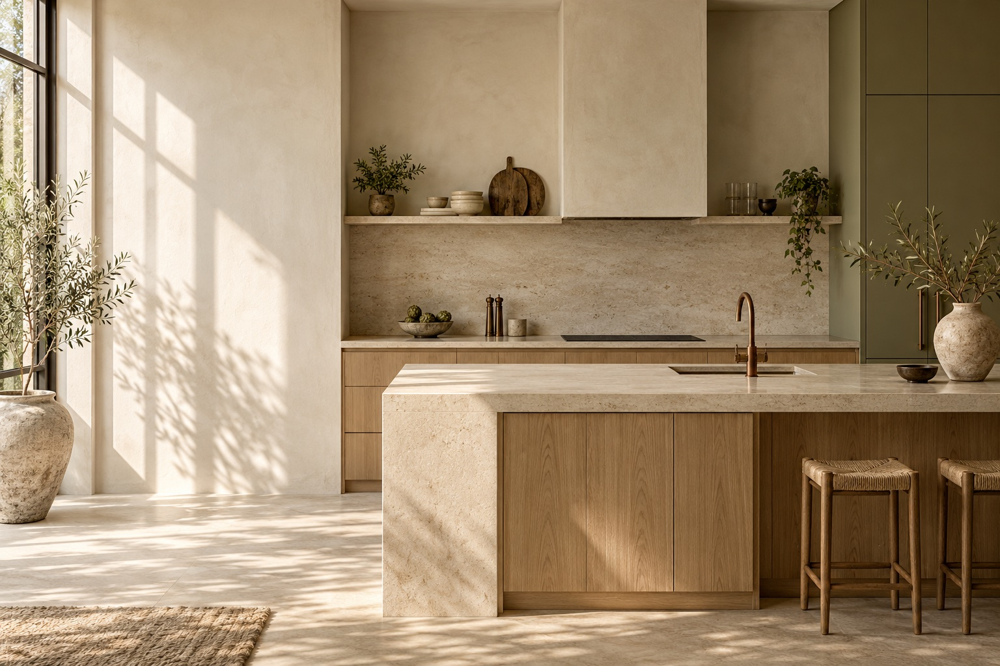

# FORMA MEBEL

Сайт мебельной фабрики с интерактивным **2D-конфигуратором кухни**. Пользователь задаёт размеры, размещает модули, выбирает материалы и сразу видит стоимость проекта.



Портфолио-проект на React и TypeScript: тёплая минималистичная главная, фотографии коллекций, SVG-чертёж кухни и формы записи на замер.

## Возможности

- Прямая, Г- и П-образная планировки, размеры помещения и глубина кухни.
- Добавление, перемещение и удаление модулей; проверка границ, пересечений и углов.
- Вид сверху и фасады, масштабирование, текстуры и цветовые решения.
- Расчёт стоимости с разбивкой по материалам и комплектующим; печатная смета для сохранения в PDF.
- Undo/Redo, автосохранение, именованные проекты и перенос настроек по ссылке.
- Каталог с фильтрами и галереей, сравнение материалов, анимированный FAQ.
- Календарь замера, маска телефона с фиксированным +7, анимированные подтверждения.
- Адаптивная вёрстка, управление с клавиатуры, локальные шрифты и поддержка уменьшения анимации.

## Стек

React 19 · TypeScript · Vite · Framer Motion · Radix UI · SVG · Vitest · Playwright.

## Локальный запуск

Нужен **Node.js 22.12+**. Рекомендуемая версия указана в `.nvmrc`.

```sh
nvm use               # если используете nvm
npm ci
npm run dev
```

Откройте адрес из вывода Vite. По умолчанию это `http://localhost:5173`; если порт занят, Vite выберет следующий. Для порта 5175:

```sh
npm run dev -- --port 5175
```

Переменные окружения, API-ключи и подключение к базе данных для запуска не требуются.

## Проверки

```sh
npm test                         # геометрия, цены, история, телефон, локальные сервисы
npm run build                    # TypeScript + production-сборка в dist/
npx playwright install chromium  # браузер для e2e, один раз после установки
npm run test:e2e                  # браузерные сценарии на порту 5175
npm run preview                  # локальный просмотр production-сборки
```

Playwright сам запускает dev-сервер. В локальной среде может использовать уже запущенный сервер на порту 5175. В CI создаётся отдельный сервер. Для нестандартной установки Chromium можно передать `PLAYWRIGHT_CHROMIUM_EXECUTABLE_PATH`.

GitHub Actions выполняет установку по lock-файлу, модульные тесты, сборку и браузерные сценарии при push в `main` и в pull request. Диагностика упавших браузерных тестов сохраняется как артефакт.

## Публикация исходников на GitHub

Создайте пустой репозиторий, например `forma-mebel`, без автоматически добавляемого README. В корне проекта:

```sh
git add .
git commit -m "Initial commit: FORMA MEBEL website and kitchen planner"
git remote add origin https://github.com/YOUR_USERNAME/forma-mebel.git
git push -u origin main
```

Замените `YOUR_USERNAME` своим логином. Для первого коммита Git должны быть заданы ваши `user.name` и `user.email`.

## Развёртывание сайта

### Vercel

Импортируйте GitHub-репозиторий как Vite-проект:

| Настройка | Значение |
| --- | --- |
| Install command | `npm ci` |
| Build command | `npm run build` |
| Output directory | `dist` |

Конфигурация уже находится в `vercel.json`. После подключения репозитория новые коммиты запускают развёртывание автоматически.

### Другой статический хостинг

Загрузите содержимое `dist/` в корень домена. Навигация использует URL-фрагменты, поэтому серверные маршруты не требуются. Текущая конфигурация рассчитана на корень домена, а не на подпапку вида `/repository/`.

## Структура

```text
src/
  components/
    configurator/   # мастер проектирования и SVG-чертёж
    site/           # главная и запись на замер
    ui/             # общие элементы интерфейса и анимации
  data/             # коллекции, материалы и расценки
  domain/           # геометрия, расчёт стоимости, история и валидация
  services/         # localStorage, календарь, CRM-контракт и печатная смета
public/             # изображения и favicon
tests/              # браузерные сценарии
.github/workflows/  # автоматические проверки
```

Цены и материалы настраиваются в `src/data/materials.ts`, формула расчёта — в `src/domain/pricing.ts`.

## Данные и границы портфолио-версии

Проект работает полностью в браузере. Это концепция бренда, а коллекции и цены служат примером работы интерфейса.

- Черновик и сохранённые проекты находятся в `localStorage` текущего браузера. Ссылка «Поделиться» содержит только настройки кухни.
- Занятость календаря локальна: хранятся только ключи `дата|время`. Она не синхронизируется между посетителями.
- Имена, телефоны и сообщения не сохраняются и не отправляются. Подтверждение формы показывает сценарий взаимодействия.
- Для реального приёма заявок нужно подключить серверную реализацию `CRMAdapter` из `src/services/crm.ts` и общий календарь. Секреты CRM должны оставаться на сервере.
- Расчёт предварительный; техника, доставка и монтаж в него не включены.

## Изображения и сторонние материалы

Фотографии коллекций взяты с Unsplash и Pexels. Авторы, исходные страницы и лицензии перечислены в [public/images/CREDITS.md](public/images/CREDITS.md). Hero и интерьерная иллюстрация сгенерированы для проекта. Шрифты Cormorant и Montserrat поставляются локально через пакеты Fontsource; зависимости сохраняют собственные лицензии.
